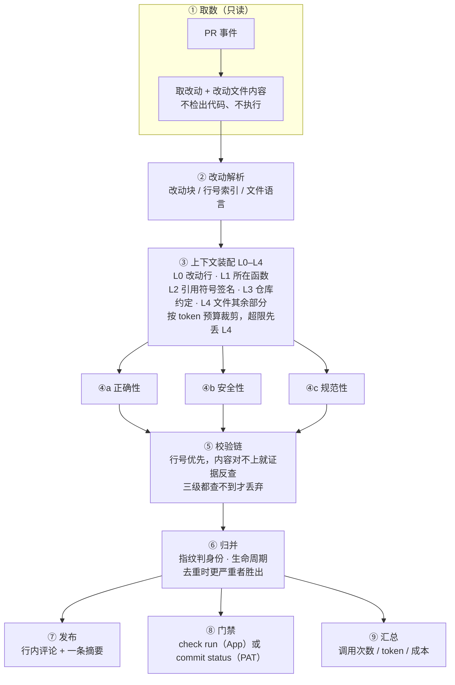
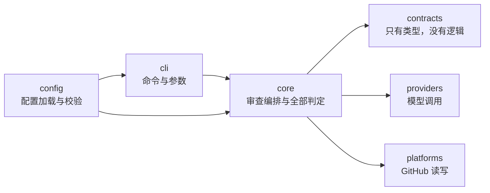

# AI 代码审查

给合并请求做三维审查，把结论贴到**改动对应的那一行**；给整个仓库做定期体检并给出可对比的分数。

**它只做审查**：不改代码、不合并、不判断「能不能上线」。产出是「定位到行、能被复核」的问题清单，外加一个能真正挡住合并的状态。

## 做与不做

| 做                                                   | 不做                                                     |
| ---------------------------------------------------- | -------------------------------------------------------- |
| 审「这次改动新引入的问题」，贴到改动行               | 不审存量代码（存量归巡检，两件事的判据完全不同）         |
| 门禁：符合条件的致命问题 → 合并按钮变红              | 不替人决定合并；豁免、绕过都由人做                       |
| 巡检：复杂度 / 重复 / 依赖 / 类型 / 测试五个维度打分 | 不做安全审计、不做覆盖率统计（那是别的工具的活）         |
| 结论可复现：同样的输入，跑两次结果一致               | 不做「更聪明的对话式审查」，也不要模型自由发挥的额外建议 |

## 架构

下面两张图回答不同的问题：**第一张是一次审查怎么走完的**，**第二张是代码怎么分层、谁可以依赖谁**。





依赖方向是单向的：`platforms` 与 `providers` 都只认 `contracts` 里的接口，`core` 不知道对面是 GitHub 还是别的东西。换平台只需要再写一份 `platforms/`，`core` 一行不动。

## 三个能力，各自的边界

### 1. 改动审查

- **做**：对每个改动文件，按三个维度各调用一次模型；结论必须落到「文件 + 行 + 那一行的原文证据」。
- **边界**：只看这次改动引入的问题。一行没动的老问题不报——那是巡检的职责，混在一起会让作者觉得「每次都在念同一本经」。
- **边界**：跨文件只做到「被引用符号的签名」这一层（L2）。它不做全仓库调用图，所以「这个改动会让三天前那个模块出错」这类结论，它给不出来。
- **已知限制**：模型给的行号不可信，所以有校验链。校验不过的结论会被丢弃并记录原因——**丢弃是有痕迹的**，不是静默消失。

### 2. 门禁

- **做**：判定哪些问题足以挡住合并，把结果写成平台状态（`failure` / `success`）。
- **边界**：只有四个条件同时成立才拦：严重度为 `blocker` + 证据通过校验 + 置信度达标 + 类别在 `blockingCategories` 里。规则命中的问题不需要置信度（判据是确定的）。
- **硬限制**：创建 check run **必须用 GitHub App**，个人令牌无论给什么权限都写不了；所以对 PAT 用户走 `commit status`。两者在分支保护里都能设为必需检查，差别是前者能带行级注解。
- **端点**：状态写出来了，合并按钮也不会红——**必须在分支保护里把 `AI 代码审查` 设为 required check**。这一步只能人工在网页做。

### 3. 项目巡检

- **做**：确定性扫描源码，算五个维度的分，和上一期比趋势。
- **边界**：分数是公式算的，不由模型打分。同一份代码今天 78 明天 71，用户看两次就不信了。
- **边界**：它回答「这个仓库在哪些结构指标上偏离了常见阈值」，不回答「代码写得好不好」。
- **端点**：报告写进 Wiki（若开启）或一条常设 Issue（建完立即关闭）。后者需要 `issues: write`，缺权限会明确告警而不是静默失败。

## 模型被调用的地方（以及刻意不调用的地方）

全部模型调用只有四种形态，都是「给材料 → 要一份结构化结论」。**没有任何一处让模型决定流程或取材。**

| #   | 调用点     | 触发条件                   | 一次调用的输入                                                             | 输出契约                                             | 失败怎么办                                                       |
| --- | ---------- | -------------------------- | -------------------------------------------------------------------------- | ---------------------------------------------------- | ---------------------------------------------------------------- |
| 1   | 正确性维度 | 每个改动文件一次           | 系统提示 + 该文件适用的规则块 + L0–L4 上下文                               | JSON：`findings[]`（行号、类别、严重度、证据、建议） | 单条校验不过就丢该条并记录原因；整次失败记入拒绝列表             |
| 2   | 安全性维度 | 同上                       | 同上（规则块换成安全类）                                                   | 同上                                                 | 同上                                                             |
| 3   | 规范性维度 | 同上，但规则注入按条件收窄 | 同上（格式类规则只在仓库没有 lint 配置时注入；单测类规则只在测试路径注入） | 同上                                                 | 同上                                                             |
| 4   | 截断重试   | 输出撞到长度上限时         | 同一份材料，按保留优先级收缩一次                                           | 同上                                                 | 仍截断则放弃并留痕，**不把截断归因成格式错误**（会带偏排查方向） |

调用参数是固定的：温度 `0.2`、输出上限 `4096`、**单次请求 180 秒超时**（超时按可重试处理，最多 3 次）。结构化输出按三档降级——`json_schema` → `json_object` → 纯文本解析，且只在错误信息**明确指向** `response_format` 时才降级，不做「400 就当不支持」的粗暴判断（400 也可能是密钥错了，那样会把错误藏起来）。

超时这一条是实测补的，理由值得单独说：没有超时的 `fetch` 在连接被中间设备挂住时**永远不返回**。命令行看起来在跑、CI 一直占着 runner、日志里什么都没有——比报错难排查得多。第一次跑真实 PR 就是这么卡了 40 分钟才被发现。

模型路由分三档，按优先级：**文件风险**（碰钱、碰权限、碰加解密用强模型）→ **维度**（规范性不需要强推理）→ **规模**（小改动降档，**默认关闭**）。最后一条默认关，是因为「改动小所以简单」是个反直觉的错误假设：一行改动可能影响全局，而模型看到的信息量恰恰最少。

**刻意不交给模型的**（这些判据是确定的，让模型做只会引入不可复现）：

| 事                   | 谁做                | 为什么                                             |
| -------------------- | ------------------- | -------------------------------------------------- |
| 挑哪些规则进上下文   | 代码（1ms 筛完）    | 模型自己挑会跳过它认为不重要的，而且不告诉你       |
| 结论定位到哪一行     | 行号校验 + 证据反查 | 模型给的行号经常差一两行，直接用会贴到无关的代码上 |
| 两条结论是不是同一个 | 指纹                | 措辞每轮都变，交给模型判断等于每轮重新洗牌         |
| 该不该阻塞合并       | 固定条件合取        | 这是有人会跟你吵的决定，必须能逐条解释             |
| 硬编码密钥           | 正则                | 实测三个维度全漏，而且漏得毫无提示                 |
| 巡检分数             | 公式                | 见上，分数必须可复现                               |

## 规则库

**170 条规则**（强制 113 / 推荐 43 / 参考 14），覆盖 Java 后端与前端工程规约：

| 来源                           | 条数 | 说明                                                      |
| ------------------------------ | ---- | --------------------------------------------------------- |
| 《阿里巴巴Java开发手册》v1.3.0 | 150  | 提炼成可判定条件，不照抄条文；每条标 `basis` 能追回原章节 |
| 前端工程规约                   | 14   | 命名、异步、状态管理一类                                  |
| 本项目自撰                     | 6    | 与本工具自身形态相关的问题                                |

手册的 **215 条**条款里，**158 条**落成规则、**57 条**明确排除——每条排除都写明原因（需人工判断、需仓库上下文、属运维配置等）。这不是一句承诺，是可执行的断言：`checkCoverage()` 会报出「某条既没写成规则也没排除」「规则引用了不存在的条款」「两边说法不一致」三类问题，任何一类非空测试就失败。覆盖明细与来源见 [NOTICE.md](NOTICE.md)。

**硬编码凭证是确定性规则**，不走模型（实测三个维度全漏）。它有两条让假凭证不被误报的出口：

- 占位符判据：不同字符占比过低、**整串字典序**（`abcdef…z0123` 这种手敲的）、含 your / changeme 一类字样；
- 行内标注 `acr-allow-secret`：高熵的假令牌（脱敏测试里的 `sk-live-...`）靠启发式分不干净，让作者显式声明。

刻意**不**给「测试目录整体跳过」这种口子——真令牌泄露在测试目录里也照样是泄露，只是不阻塞合并这件事得由人来判断。

## 快速开始

接入到自己的仓库，看 **[docs/setup.md](docs/setup.md)**。

三步：仓库 Secrets 里配 `AI_REVIEW_API_KEY` → 把 `.github/workflows/review.yml` 复制进仓库 → 想真发评论就把仓库变量 `ACR_MODE` 设成 `review`（默认是 `dry-run`，只打印不写）。所有开发者不用配任何东西。

默认 `dry-run` 是刻意的：PR 一建出来就会触发，此时工具还没被验证过，直接往仓库里写评论是冒犯。「产生副作用」应该是显式动作，不是默认行为。

## 命令行

```bash
node dist/cli.js review --repo owner/name --pr 123        # 真发评论 + 写状态
node dist/cli.js dry-run --repo owner/name --pr 123       # 只打印，不写任何东西
node dist/cli.js dry-run --repo owner/name --commit abc   # 审单笔提交（只能 dry-run）
node dist/cli.js cost --files 10 --lines 400              # 预估费用
node dist/cli.js inspect [--write] [--coverage 80]         # 仓库巡检
node dist/cli.js eval --dataset evals/dataset.json --out now.json      # 跑评测集
node dist/cli.js eval --baseline before.json --current now.json        # 两次跑分对比
```

PR 编号的来源优先级：`--pr` > `ACR_PULL_REQUEST` > GitHub 事件文件。空的 `ACR_PULL_REQUEST` 会被当成「没设置」继续往下找——这个坑真踩过：调用方传一个空串进来，会把 Action 里写的默认值覆盖掉。

## 目录

```
src/
  contracts/     类型定义（不含逻辑）
  core/
    diff/        改动解析与行索引
    context/     L0–L4 上下文、跨文件索引、符号表、预算
    reviewers/   三个维度 + 规则库（rules/）
    verify/      双轨定位与校验链
    reconcile/   指纹、标记、生命周期、检查点
    publish/     评论发送与摘要维护
    gate/        门禁判定
    routing/     模型路由
    cost/        计价
    inspection/  巡检指标、评分、报告与载体
    eval/        评测集匹配与基准对比
  providers/     模型调用（OpenAI 兼容）
  platforms/     平台适配（GitHub）
  config/        配置加载与校验
  cli/           命令行
dist/cli.js      构建产物（必须入库，见下）
tests/           50 个文件 / 588 个通过 + 4 个跳过
```

`dist/cli.js` **必须入库**：GitHub 执行 Action 时不会替你装依赖，也不会替你构建，远端直接跑仓库里这个文件。`pnpm run verify:dist` 会重新构建到临时文件再逐字节比对，防止「改了源码忘了重新构建」。

## 当前状态

**已在真实仓库跑通**（不是「代码写完了」）：

| 能力         | 证据                                                                      |
| ------------ | ------------------------------------------------------------------------- |
| 改动审查     | 4 个模拟 PR / 35 条行内评论 / 覆盖 30 个不同行，逐条与源码核对无编造      |
| 门禁真实阻塞 | 写在真实仓库的 commit status 上，状态为 `failure`，描述是「1 个致命问题」 |
| 巡检写入     | 报告写进真实 Issue 并立即关闭；标签自动创建，连跑两轮编号不变、条目不增   |
| 评测         | 18 条标注的样本集；关掉类别映射前后，标注命中率 5.6% → 88.9%              |

真实开销参考：一次 35 个文件 / 2837 行的 PR 审查 = **43 次模型调用**，输入 232k + 输出 123k token，约 **$0.19**。那次耗时 40 分钟是被一个卡住的请求拖的（已加超时），正常量级是数分钟。

**仍未在真实环境验证**（代码完成、单测通过，但没跑出过结果）：

| 能力           | 缺什么                                    |
| -------------- | ----------------------------------------- |
| 检查点增量审查 | 需要连续两次推送才能观察                  |
| 模型路由阈值   | 没有真实数据，默认关闭                    |
| check run 注解 | 需要 GitHub App；PAT 只能写 commit status |

这些不是已知缺陷，是**验证空缺**——两者要分开说。

## 文档

| 文件                                   | 内容                                       |
| -------------------------------------- | ------------------------------------------ |
| [`01-实现规格书.md`](01-实现规格书.md) | 设计决策的全量论证（含失败矩阵与竞品对照） |
| [`docs/setup.md`](docs/setup.md)       | 接入步骤（Secret、workflow、dry-run）      |
| [`NOTICE.md`](NOTICE.md)               | 规则来源与覆盖情况                         |

## 开发

```bash
pnpm install
pnpm run ci          # 格式 + 类型 + 检查 + 测试 + 产物冒烟 + 产物一致性
pnpm run test        # 只跑测试
pnpm run build       # 打包成单文件 dist/cli.js
```

需要 Node.js ≥ 20 与 pnpm。
