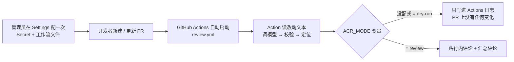

# AI 代码审查 · 接入指南

> **本文件是接入说明**（怎么用）。第一次用，从下面的第 3 节「五步接入」照着做即可。
> 想了解架构与设计上的取舍，看 [架构与设计说明](docs/architecture.md)；
> 设计决策的全量论证看 [01-实现规格书.md](01-实现规格书.md)；
> 实测暴露的缺陷与面试复盘看 [项目复盘](docs/项目复盘-AI代码审查.md)；规则来源看 [NOTICE.md](NOTICE.md)。

这份文档写给**第一次用这个工具、也不熟 GitHub Actions 的人**。主流程全程在 GitHub 网页上点，不用敲命令、不用装 Node.js。

只想在自己电脑上试跑一次（调提示词、复现问题），直接跳到 [第 10 节：路径 B](#s10)。

---

## 0. 装好之后会发生什么

管理员配一次，之后**仓库里所有人都不用配任何东西**：

- 有人开了一个 PR，或往 PR 里推了新代码 → GitHub 自动跑一次审查
- 审查结论贴在**改动的那一行**上，另有一条汇总评论说明整体情况
- 默认**只打印、不发评论**（叫 `dry-run`）；你确认结果靠谱后，打开一个开关才会真写

下面这张图只回答一个问题：**从「你点了一下」到「PR 上出现评论」，中间经过谁**。



> 图里的 `ACR_MODE` 是第 5 步才配的开关。**默认走「只打印」那条分支**，这是刻意的：PR 一建出来就会触发，此时工具还没被验证过，直接往别人仓库里发评论是冒犯。

---

## 1. 先认识 6 个词（30 秒）

| 词                     | 大白话                                                                |
| ---------------------- | --------------------------------------------------------------------- |
| **PR**（Pull Request） | 「我改了代码，请合并进主分支」的请求。审查就是针对它做的              |
| **Actions / 工作流**   | GitHub 自带的自动化。一个 `.yml` 文件写清「什么时候触发、干什么」     |
| **Secret**             | 加密保存的值，建完**不能再查看**，日志里显示成 `***`。放密码、API key |
| **Variable**           | 明文保存的值，随时能看能改。放开关、模式这类不算机密的东西            |
| **Token**（令牌）      | 一段字符串，代替密码让程序有权读写你的仓库                            |
| **dry-run**            | 空跑：全部步骤照做，但**不往仓库写任何东西**，只把结果打印到日志      |

一句话记住：**API key 必须放 Secret，放 Variable 等于明文公开。**

---

## 2. 开始前准备三样东西

1. **目标仓库的管理员权限** —— 要能进 `Settings`。普通成员看不到配 Secret 的入口。
2. **一个模型 API key** —— 本项目默认用 DeepSeek，去它的控制台创建，形如 `sk-` 开头的一长串。模型按量收费，见 [第 11 节](#s11)。
3. **能读到本项目的 Action** —— 工作流里写的是 `uses: 1Egbert1/code-review@main`，这个仓库是公开的，一般直接可用。读不到怎么办见第 3 步末尾。

**在 Action 里不需要另建 GitHub 令牌**：GitHub 会自动注入一个内置的 `GITHUB_TOKEN`，权限由工作流文件里的 `permissions:` 决定。只有**本地调试**或者**跨仓库写入**才需要自己建 PAT，那是 [第 10 节](#s10) 的事。

---

## 3. 五步接入（只做一次）

### 第 1 步：把模型 key 存成 Secret

路径：仓库页 → **Settings** → 左侧 **Secrets and variables** → **Actions** → 上方 **Secrets** 标签 → **New repository secret**

| 字段   | 填什么                         |
| ------ | ------------------------------ |
| Name   | `AI_REVIEW_API_KEY`            |
| Secret | 从模型控制台复制的那一整串 key |

点 **Add secret**。

- 名字必须和 `.ai-review.yml` 里的 `llm.apiKeyEnv` 一致，默认就是 `AI_REVIEW_API_KEY`。改过配置就按配置里的名字建。
- 建完页面上不会再显示这个值，**只能覆盖**，这是正常的。
- 想让多个仓库共用一个 key：去**组织**的 Settings → Secrets and variables → Actions → New organization secret，在 _Repository access_ 里勾选仓库。仓库级同名时会覆盖组织级。

### 第 2 步：把审查工作流放进仓库

把本项目的 [`.github/workflows/review.yml`](https://github.com/1Egbert1/code-review/blob/main/.github/workflows/review.yml) 内容**原样复制**，在目标仓库里新建同名文件（`.github/workflows/review.yml`），提交到**默认分支**（通常是 `main`）。

这一步不能跳，也不能只在 PR 里改这个文件：`pull_request_target` 事件**只认默认分支上的工作流文件**。PR 里带的那份不会生效，改 action 也是同理——必须合并进 `main` 之后，下一个 PR 才会用上新版本。

文件里有三处别删：

```yaml
permissions:
  contents: read # 读文件内容
  pull-requests: write # 发行内评论
  issues: write # 发汇总评论（它属于 issue comment）
  checks: write # 开门禁时要写状态
```

新仓库的内置令牌默认只读，不写这四行，发评论时会拿到 403，而日志看起来像「权限不足」而不是「配置漏了」。另外文件里的 `concurrency` 也别删：连续推送会触发多次，不串行化的话两次审查会同时改同一批评论，出现「删了又建」「同一问题贴两遍」。

> **如果目标仓库读不到 `1Egbert1/code-review`**（例如组织策略不允许引用外部 Action）：把本项目的 `action.yml` 和 `dist/cli.js` 一起复制进目标仓库，在工作流的 `steps:` 开头加一行 `uses: actions/checkout@v4`，再把 `uses: 1Egbert1/code-review@main` 改成 `uses: ./`。
> **checkout 保持默认，绝对不要给它加 `ref` 指向 PR 的分支**——见 [第 12 节](#s12)。生产环境建议把 `@main` 换成一个固定的 commit SHA，避免上游一改你的行为就跟着变。

### 第 3 步：建一个测试 PR（**要改代码文件**）

在 GitHub 网页上就能做，不用本地克隆：

1. 打开仓库首页，点进**任意一个代码文件**（`.ts`、`.js`、`.py` 都行）
2. 右上角**铅笔图标**（Edit this file）
3. 在末尾加一行注释，比如 `// 试一下自动审查`
4. 下方选 **Create a new branch for this commit and start a pull request**，分支名填 `test/first-review`
5. 点 **Propose changes** → 再点 **Create pull request**

⚠️ **不要只改 `README.md` 或别的 `.md` 文件来测试。** Markdown 文档默认不进审查集（见 [第 8 节](#s8)），只改它的话日志会显示「0 个文件要审」，看起来像工具坏了，其实行为是对的。

PR 一创建，审查就自动开始。草稿 PR 不会被审（还没写完，报出来的问题大多会被改掉）。

### 第 4 步：看这次跑通没有

1. 进仓库的 **Actions** 页
2. 左侧选 **AI 代码审查**，最上面那条就是刚才触发的
3. 点进去 → 展开 `Run 1Egbert1/code-review@main` 这一步看日志

健康的日志会有「取到 N 个文件」、审查过程的统计、以及最后一段费用与丢弃原因。重点看 [第 11 节](#s11) 那几行。

**这时 PR 上不会出现任何评论，这是对的**——默认 `dry-run`。如果日志里只有一行红色报错，对照 [第 9 节](#s9)。

### 第 5 步：确认结论可接受，再打开真发评论

路径：**Settings** → **Secrets and variables** → **Actions** → **Variables** 标签 → **New repository variable**

| 字段  | 填什么     |
| ----- | ---------- |
| Name  | `ACR_MODE` |
| Value | `review`   |

之后**新建或更新的 PR** 就会真发评论了。已经跑过的那次不会自动重跑：去 Actions 页点 **Re-run all jobs**，或者往 PR 里再推一个空提交。

想退回只打印：把 `ACR_MODE` 改成 `dry-run`，或直接删掉这个变量（没有它就是默认 `dry-run`）。

> 也可以不配变量，用手动触发单次指定：Actions 页 → 左侧 **AI 代码审查** → 右侧 **Run workflow** → 填 PR 编号、把 mode 选成 `review` → 跑。这个优先级高于 `ACR_MODE`。

---

## 4. 三条流水线，各自的用途

本项目 `.github/workflows/` 下有三个文件，**接入时只需要复制 `review.yml` 这一个**。

| 文件          | 什么时候跑                                           | 干什么                                                                  | 要不要复制到你的仓库           | 会往仓库写东西吗            |
| ------------- | ---------------------------------------------------- | ----------------------------------------------------------------------- | ------------------------------ | --------------------------- |
| `ci.yml`      | 推到 `main`、开 PR                                   | 跑本项目自己的测试、类型检查、格式检查，并校验 `dist/cli.js` 与源码一致 | **不用**（这是开发本项目用的） | 不写                        |
| `review.yml`  | PR 创建 / 更新 / 重新打开 / 草稿转正式；也可手动触发 | 审这次改动，贴评论                                                      | **必须**                       | 只打印，或贴评论            |
| `inspect.yml` | 每月 1 日 02:00 UTC（北京 10:00）；也可手动触发      | 巡检整个仓库，出一份结构指标报告                                        | 可选                           | 写一条常设 Issue 或 Wiki 页 |

`inspect.yml` 里写的是 `uses: ./`，**这只有在本项目自己仓库里才成立**（Action 定义和它在同一个仓库）。复制到别的仓库时，这一行要改成指向 Action 实际所在的位置，否则会报「找不到 action.yml」。它还会把本期历史提交回 `.acr/inspection-history.json`，所以需要 `contents: write`。

---

## 5. 环境变量总表

这是本项目**实际会读到**的全部变量。分成三类，别混。

### A. 需要你在网页上配的（只有 2 个）

| 名称                | 放哪         | 值                           | 不配会怎样                                    |
| ------------------- | ------------ | ---------------------------- | --------------------------------------------- |
| `AI_REVIEW_API_KEY` | **Secret**   | 模型服务的 key               | Action 直接报「缺少 AI_REVIEW_API_KEY」并停下 |
| `ACR_MODE`          | **Variable** | `dry-run`（默认）或 `review` | 不配就是 `dry-run`，只打印不写                |

`ACR_MODE` 是 GitHub 的 **Variable**，不是你电脑上的环境变量，也不是 Secret。它只是个开关，明文没问题。

### B. GitHub / Action 自动注入的（**不用配**）

| 名称                                                   | 谁给的                                    | 用途                  |
| ------------------------------------------------------ | ----------------------------------------- | --------------------- |
| `GITHUB_TOKEN`                                         | `action.yml` 用内置的 `github.token` 注入 | 读写 PR / Issue       |
| `ACR_REPOSITORY`                                       | `action.yml` 用 `github.repository` 注入  | 告诉工具审哪个仓库    |
| `ACR_PULL_REQUEST`                                     | `action.yml` 从事件上下文注入             | 告诉工具审哪个 PR     |
| `GITHUB_REPOSITORY`、`GITHUB_EVENT_PATH`、`GITHUB_SHA` | GitHub Actions 运行环境自带               | 巡检写入、PR 编号兜底 |

> PR 编号的来源是 `--pr` > `ACR_PULL_REQUEST` > GitHub 事件文件。空字符串会被当成「没设置」继续往下找——这个坑真踩过：调用方传一个空串进来，会把 Action 里写好的默认值覆盖掉，表现为「缺少审查对象」。

### C. 本地调试时才用的（[第 10 节](#s10)）

`GITHUB_TOKEN`（这次是你自己建的 PAT）、`AI_REVIEW_API_KEY`，以及可选覆盖 `ACR_MODEL`、`ACR_BASE_URL`、`ACR_REPOSITORY`。

**不要把密钥写进 `.ai-review.yml`** —— 那个文件要进版本库。配置里写的是「去哪个环境变量里取」（`apiKeyEnv`），不是值本身。

> 补充一句信息边界：用个人访问令牌（PAT）**读不到仓库的 Secrets / Variables 列表**（接口返回 403，这是 GitHub 对 PAT 的限制，不代表没配）。所以核对名称、确认有没有建，请在网页上看，不要以「接口查出来是空的」为准。

---

## 6. 权限清单 <a id="s6"></a>

### 工作流里（内置令牌）

就是第 2 步那四行 `permissions:`。**只开这四项**，别图省事写 `write-all`。

### 自己建 PAT 时（本地跑 / 门禁写状态）

访问 <https://github.com/settings/personal-access-tokens> → **Fine-grained tokens** → Generate new token：

| 字段 / 权限       | 设成                                      | 为什么                                                            |
| ----------------- | ----------------------------------------- | ----------------------------------------------------------------- |
| Repository access | **Only select repositories** → 选目标仓库 | 不要给全部仓库                                                    |
| Expiration        | 7~30 天                                   | 短期，泄露了影响也有限                                            |
| Contents          | Read-only                                 | 读文件内容；只在你要用这个令牌推送提交时才需要改成 Read and write |
| Pull requests     | Read and write                            | 发、改行内评论                                                    |
| Issues            | Read and write                            | 发汇总评论、写巡检报告 Issue                                      |
| Commit statuses   | Read and write                            | 门禁把结果写成状态                                                |
| Metadata          | Read-only（必选，自动带）                 | GitHub 要求的基础权限                                             |

不要选 Classic token 的 `repo`：那是整个私有仓库的读写全权，对这个场景过重。

---

## 7. 两个可选功能

### 7.1 门禁：让有致命问题的 PR 合并不了

默认**关闭**。开启要同时做两件事，缺一件都看不到「合并按钮变红」：

1. 在 `.ai-review.yml` 里把 `gate.enabled` 改成 `true`（四个条件同时成立才拦：严重度 `blocker` + 证据通过校验 + 置信度达标 + 类别在 `blockingCategories` 里）。
2. 网页上配分支保护：仓库 **Settings** → **Branches** → `main` 的保护规则 → 勾 **Require status checks to pass** → 搜索并选中 **`AI 代码审查`** → 保存。

两个容易懵的点：

- **「状态写出来了」≠「按钮变红了」**。工具只负责把状态写成 `failure`，要不要拦是分支保护说了算，这一步只能人工在网页做。
- 用**个人令牌（PAT）时不能创建 check run**（那需要 GitHub App），所以工具会降级成 **commit status**。它显示在 PR 页面底部的状态区，**不在 Checks 标签页里**——去 Checks 里找会找不到，这是正常的，不是没跑。

### 7.2 巡检：每月一份仓库结构报告

可选。复制 `inspect.yml`（注意第 4 节说的 `uses: ./`），它会：

- 用确定性公式算五个维度的分，和上一期比趋势（**分数不由模型打**，保证可复现）
- 报告写进 **Wiki**（仓库开了 Wiki 时优先）或**一条常设 Issue**：标签 `acr-inspection` 会自动创建，报告写完立即关闭，不会留一条 open Issue 一直要人管
- 需要 `issues: write`（用 Wiki 还要 `contents: write`）

---

## 8. 配置文件 `.ai-review.yml` <a id="s8"></a>

放在仓库根目录，**只写和默认值不同的项**，其余用默认（见 `src/config/defaults.ts`）。本项目自己那份就是个例子。

最常改的三处：

| 想改什么                       | 改哪里              |
| ------------------------------ | ------------------- |
| 审哪些维度、各自最低报什么级别 | `review.dimensions` |
| 跳过哪些文件                   | `review.skipPaths`  |
| 门禁开关 / 阻塞类别            | `gate`              |

⚠️ **`skipPaths` 是整组替换，不是追加**。你一旦在配置里写了这一节，默认清单就被整组覆盖了。默认清单包含 `**/*.md`（Markdown 文档，含 README）、锁文件、构建产物、压缩文件。所以**想审代码又想保留默认跳过项时，把默认那几条一并抄进来**；反过来，想审 Markdown 就写一份不含这一项的清单。

> 为什么默认不审 Markdown：文档确实能审出问题（实测在规格书里找出过前后不一致），但几千行的文档会吃掉单次调用的大部分上下文，取舍上把额度留给代码。

另外，`mode` **不在**配置文件里——它在仓库 Variable `ACR_MODE` 或工作流的手动触发选项里。

---

## 9. 常见错误对照 <a id="s9"></a>

| 现象                         | 原因                                                              | 怎么办                                                    |
| ---------------------------- | ----------------------------------------------------------------- | --------------------------------------------------------- |
| 工作流加了但没跑             | `pull_request_target` 只认**默认分支**上的工作流文件              | 先合并进 `main`，再开新 PR                                |
| `缺少 AI_REVIEW_API_KEY`     | Secret 没建，或名字与 `llm.apiKeyEnv` 不一致                      | 按配置里的名字建 Secret                                   |
| `缺少审查对象`               | PR 编号没传进来（多见于手填参数或改过工作流）                     | Actions 页手动触发时填 PR 编号；检查 `pull-request:` 那行 |
| 日志显示「0 个文件要审」     | 这次只改了 Markdown / 构建产物 / 锁文件                           | 换个代码文件试；这些默认跳过是对的                        |
| 发评论 403                   | `permissions` 没声明，或 PAT 少给了 Pull requests / Issues 写权限 | 补 `permissions` 或改 PAT 权限                            |
| PR 上一片安静、没有评论      | 还在 `dry-run`                                                    | 建 `ACR_MODE=review`，再 Re-run                           |
| 模型 401                     | key 错、没余额、或名字不对                                        | 去模型控制台看余额；Secret 只能覆盖重建                   |
| 模型 404                     | base URL 或模型名不对                                             | 对照官方文档；模型名变动很快                              |
| `缺少仓库`                   | 本地跑没传 `--repo`                                               | 加 `--repo owner/name`                                    |
| `配置错误` + 字段路径        | `.ai-review.yml` 有未知键或类型不对                               | 按提示改；不确定就删掉那几行用默认值                      |
| 门禁写了 `failure`，按钮没红 | 没配分支保护                                                      | 见 7.1 第 2 步                                            |
| 在 Checks 标签页找不到状态   | 用的是 PAT，走的 commit status                                    | 看 PR 底部状态区，见 7.1                                  |
| 巡检报 403                   | PAT 缺 `Issues: Read and write`，或权限改了没保存                 | 网页改完确认保存，再跑一次                                |

---

## 10. 路径 B：在自己电脑上跑一次 <a id="s10"></a>

只在调试时用（调提示词、复现问题、看某个 PR 到底报了什么）。密钥走环境变量，**不要写死在脚本里**。

### B1. 建一个只读为主的 PAT

按 [第 6 节](#s6) 建一个细粒度令牌。只想 `dry-run` 的话，Pull requests / Issues 给 **Read-only** 就够；要 `review` 真发评论才需要 Read and write。

验证（Git Bash，把 `YOUR_GITHUB_TOKEN` 换成实际值）：

```bash
curl -s -H "Authorization: Bearer YOUR_GITHUB_TOKEN" https://api.github.com/user | head -3
```

看到 `"login": "你的用户名"` 就成了。

### B2. 设环境变量

Git Bash 里，只在**当前窗口**有效：

```bash
export GITHUB_TOKEN='YOUR_GITHUB_TOKEN'
export AI_REVIEW_API_KEY='YOUR_API_KEY'
```

想长期有效：Windows 按 `Win+R` → 输入 `sysdm.cpl` → 高级 → 环境变量 → 用户变量，新建这两个。**建完必须重开终端**才会生效。

### B3. 跑

```bash
cd F:/个人项目/ai-review

node dist/cli.js cost --files 10 --lines 400            # 先确认配置能读通
node dist/cli.js dry-run --repo owner/name --pr 123     # 只打印，仓库零变化
node dist/cli.js dry-run --repo owner/name --commit abc # 审单笔提交（只能 dry-run）
node dist/cli.js review --repo owner/name --pr 123      # ⚠️ 会真发评论
node dist/cli.js inspect --repo owner/name --write      # 巡检并写报告
```

`dry-run` 不创建评论、不改状态，仓库那边看不到任何变化。`review` 会真写，别拿生产 PR 随手试。

评测集本地跑分（改提示词前后对比，不需要 PR、不需要 GitHub 令牌，只要模型 key）：

```bash
AI_REVIEW_API_KEY='YOUR_API_KEY' node dist/cli.js eval --dataset evals/dataset.json --out before.json --label before
# 改提示词 / 改规则
AI_REVIEW_API_KEY='YOUR_API_KEY' node dist/cli.js eval --dataset evals/dataset.json --out after.json --label after
node dist/cli.js eval --baseline before.json --current after.json
```

看结果时：**召回涨、标注命中率跌** 通常是开始报更多问题，新增的可能是真的（未标注），要看明细；**复现率低于 80%** 说明模型输出不稳，单次分数不可信。详细口径见规格书 21.7。

---

## 11. 跑完看什么、大概花多少钱 <a id="s11"></a>

| 看什么       | 健康的样子               | 不正常说明什么                                            |
| ------------ | ------------------------ | --------------------------------------------------------- |
| 缓存读       | 大于 0                   | 一直是 0 = 提示词前缀不稳定，每轮重建，输入成本差约 50 倍 |
| 定位来源分布 | 大部分是「行号」         | 大量落「证据反查」= 模型写的行号不可靠                    |
| 丢弃原因     | 少量 `evidence-mismatch` | 大量丢弃 = 模型在编造代码，提示词要改                     |
| 费用         | 与改动规模相称           | 明显偏高 = 上下文塞多了，或缓存没命中                     |

**费用是实测值，不是估算**：本项目拿自己的 PR 做过一次真跑，34 个文件 / 56 次调用 / 输入约 25 万 token / 输出约 16 万 token，**约 $0.24**。更小的 PR 会明显更低；评测集只有 4 个样本，比审 PR 便宜得多，实际开销看日志里的费用行。

想提前估一下：`node dist/cli.js cost --files 10 --lines 400`。

---

## 12. 换模型（可选）<a id="s12"></a>

改 `.ai-review.yml` 的 `llm` 段，任何 OpenAI 兼容服务都行：

```yaml
llm:
  baseUrl: https://api.openai.com/v1
  model: gpt-4o-mini
  apiKeyEnv: OPENAI_API_KEY
  contextWindow: 128000
  pricing:
    inputPerMTok: 0.15
    outputPerMTok: 0.6
    cacheWriteShortMultiplier: 0
    cacheWriteLongMultiplier: 0
    cacheReadMultiplier: 0.5
```

改了 `apiKeyEnv` 就要在仓库里建**同名**的 Secret。内置预设见 `src/providers/presets.ts`：`deepseek`、`openai`、`compatible`、`ollama`。

**单价必须自己填**：不填时费用显示「无法折算」而不是 `0`——「不知道」和「免费」是两件事。

本项目 2026-11 核实过的 DeepSeek 参数：base URL `https://api.deepseek.com`、模型名 `deepseek-flash`（**已经不是** `deepseek-chat`）。**模型名和价格都会变**，接入前请对照 <https://api-docs.deepseek.com/quick_start/pricing/> 再确认一遍，不要照抄这份文档里的数字。

---

## 13. 安全边界：为什么能审外部贡献者的 PR

工作流用的是 `pull_request_target` 而不是 `pull_request`。原因很实际：**来自 fork 的 PR 在 `pull_request` 事件下拿不到仓库 Secret**（GitHub 不给 fork 提交的代码提供密钥），审查会因缺 key 直接失败。

它之所以安全，**前提只有一条：绝不检出 PR 的代码**。本 Action 只通过接口读取改动文本，从不执行 PR 里的任何东西。一旦有人在这个 job 里加了指向 PR head 的 `actions/checkout`，就会变成远程代码执行漏洞——那时 `GITHUB_TOKEN` 有写权限、模型 key 也在环境里。

所以：**不要在 `review.yml` 里加 checkout 指向 PR 分支**。第 2 步私有仓库方案里加的那个 checkout 必须保持默认（取的是仓库自己的代码），不能改成 PR 的 head。

`pull_request` 也不是不能用：如果仓库**只有本仓库分支提 PR**、没有外部贡献者，可以用它，Secret 照样能读到，且安全性更直白。两种事件都支持，取舍只在于要不要审 fork 的 PR。
